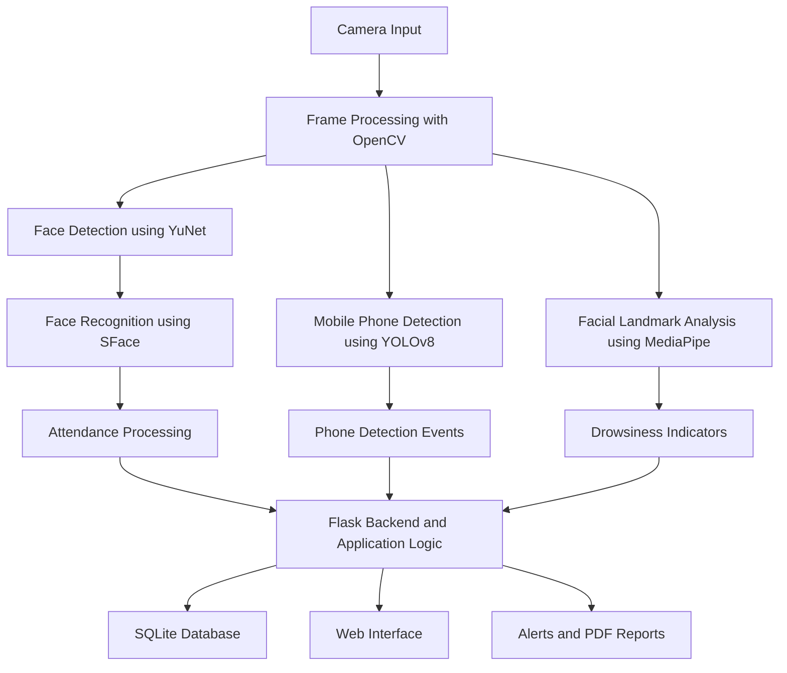

<div align="center">

# 🎓 ClassSentinel AI

### Smart Attendance & Student Monitoring System

**Making classrooms smarter through computer vision and intelligent monitoring.**

An AI-powered classroom monitoring solution combining face recognition, object detection, and facial landmark analysis to support automated attendance and classroom activity monitoring.

<br>

[](https://www.python.org/)
[](https://opencv.org/)
[](https://docs.ultralytics.com/)
[](https://flask.palletsprojects.com/)
[](https://www.sqlite.org/)

**[Explore Repository](https://github.com/Akashbs-06/Smart-Attendance-and-Student-Monitoring-System) · [Report a Bug](https://github.com/Akashbs-06/Smart-Attendance-and-Student-Monitoring-System/issues)**

</div>

---

## 💡 The Idea Behind ClassSentinel AI

Traditional attendance methods consume valuable classroom time and often require teachers to manage records manually. At the same time, monitoring classroom activities individually can be challenging.

**ClassSentinel AI** explores how computer vision can help address these challenges through an integrated monitoring system.

The project brings together student face recognition, mobile phone detection, drowsiness indicators, event tracking, and attendance reporting in one application.

The objective is to help educators access useful classroom information while reducing repetitive administrative work.

## ✨ What Makes It Different?

Rather than focusing only on attendance, this project combines several computer vision capabilities.

| Capability                | Technology                   | Purpose                                                               |
| ------------------------- | ---------------------------- | --------------------------------------------------------------------- |
| 👤 Face detection         | OpenCV YuNet                 | Locate faces in camera frames                                         |
| 🪪 Face recognition       | OpenCV SFace                 | Identify enrolled students                                            |
| 📱 Phone detection        | YOLOv8                       | Detect mobile phones in classroom images                              |
| 👁️ Drowsiness indicators | MediaPipe Face Mesh          | Analyze facial landmarks and eye-related measurements                 |
| 📊 Engagement estimation  | Application logic            | Estimate engagement using configured attendance and monitoring events |
| 🔔 Event alerts           | Python and application logic | Generate alerts for configured monitoring events                      |
| 🗃️ Data management       | SQLite                       | Store application data locally                                        |
| 🌐 Backend services       | Flask                        | Handle application requests and monitoring operations                 |
| 📑 Reporting              | FPDF2                        | Generate PDF reports                                                  |

*Detection accuracy depends on camera conditions, model performance, and application configuration. Engagement estimates are indicators, not definitive measurements of student attention.*

## 🚀 Core Features

### 1. Intelligent Attendance

* Detects faces from camera frames.
* Uses face recognition to identify enrolled students.
* Supports automated attendance recording.
* Organizes attendance information for later review.

### 2. Classroom Phone Detection

* Uses YOLOv8 for mobile phone detection.
* Supports recording relevant detection events.
* Can generate alerts according to configured detection rules.

### 3. Drowsiness Monitoring

* Uses MediaPipe Face Mesh to identify facial landmarks.
* Calculates the Eye Aspect Ratio (EAR) where implemented.
* Supports identifying potential drowsiness indicators.
* Can trigger alerts when configured conditions are satisfied.

> Drowsiness detection is an approximate computer vision indicator, not a medical diagnosis.

### 4. Engagement Estimation

The application combines configured attendance information and classroom monitoring events to estimate engagement.

The resulting score should be interpreted as an application-defined indicator rather than an objective measurement of learning or attention.

### 5. Monitoring Dashboard and Reports

The project includes web interface components and backend functionality intended to support:

* Attendance review
* Classroom event monitoring
* Alerts
* Analytics
* PDF report generation

Available functionality depends on the current application configuration.

## 🧠 How the System Works



### Processing Pipeline

1. **Capture:** Obtain frames from a configured camera source.
2. **Analyze:** Process frames using the relevant computer vision models.
3. **Recognize:** Compare detected faces against enrolled student references.
4. **Monitor:** Detect mobile phones and analyze facial landmarks.
5. **Record:** Process attendance and relevant monitoring events.
6. **Present:** Make supported information available through the web interface and reports.

## 🛠️ Technology Stack

### AI and Computer Vision

* Python
* OpenCV
* YuNet
* SFace
* YOLOv8
* MediaPipe Face Mesh
* NumPy

### Backend and Data

* Flask
* Flask-CORS
* SQLite

### Frontend and Visualization

* HTML
* CSS
* JavaScript
* Chart.js

### Reporting and Development

* FPDF2
* Git
* GitHub
* Visual Studio Code

*React.js should be listed as an implemented technology only if the current application actually uses it.*

## 📁 Project Structure

```text
Smart-Attendance-and-Student-Monitoring-System/
│
├── .github/
│   └── ISSUE_TEMPLATE/
│
├── final_year_project-main-main-main/
│   ├── backend/
│   │   └── app.py
│   │
│   ├── frontend/
│   │   ├── index.html
│   │   ├── login.html
│   │   └── chart.umd.min.js
│   │
│   ├── main.py
│   ├── camera.py
│   ├── config.py
│   ├── database.py
│   ├── detector.py
│   ├── enroll_student.py
│   ├── check_enrollment.py
│   ├── report_generator.py
│   ├── session_report_mailer.py
│   ├── timetable_helper.py
│   ├── tracker.py
│   ├── voice_alerts.py
│   ├── requirements.txt
│   ├── deploy.prototxt
│   └── haarcascade_frontalface_default.xml
│
├── .gitignore
├── CODE_OF_CONDUCT.md
├── CONTRIBUTING.md
├── LICENSE
├── README.md
└── SECURITY.md
```

*This tree highlights the main tracked files and may not include every file in your local working directory.*

## ⚙️ Getting Started

### Prerequisites

Before running the project, prepare:

* Python 3.11 or a compatible version
* Git
* A compatible webcam or configured camera source
* The required Python dependencies
* The model files referenced by the application

### Step 1: Clone the Repository

```bash
git clone https://github.com/Akashbs-06/Smart-Attendance-and-Student-Monitoring-System.git
```

### Step 2: Enter the Application Directory

```bash
cd Smart-Attendance-and-Student-Monitoring-System/final_year_project-main-main-main
```

### Step 3: Create a Virtual Environment

```bash
python -m venv .venv
```

Activate it on Windows:

```bash
.venv\Scripts\activate
```

### Step 4: Install Dependencies

```bash
python -m pip install --upgrade pip
pip install -r requirements.txt
```

### Step 5: Prepare the Model Files

Download or restore the computer vision models required by the source code from their trusted sources.

Place each model at the path expected by the application.

The `.gitignore` rules exclude certain model formats and weights, so a fresh clone may not contain all the required models.

### Step 6: Configure the Camera

Connect a compatible webcam or configure your supported Android phone webcam application.

Ensure that the camera source configured in the application matches the available device.

### Step 7: Run the Application

From the application directory:

```bash
python main.py
```

If the backend requires separate startup, consult the configuration and startup logic in `backend/app.py`.

**Note:** The commands above describe the general setup. Exact dependency compatibility, model paths, and startup requirements should be verified against the current source code.

## 🖼️ Application Screenshots

Screenshots from the actual running application will be added here.

Create a `screenshots` folder in the repository root and add genuine application screenshots.

Recommended files:

```text
screenshots/
├── attendance-dashboard.png
├── face-recognition.png
└── monitoring-alerts.png
```

Once these images have been added and pushed to GitHub, display them using:

```markdown
## Attendance Dashboard


## Face Recognition


## Classroom Monitoring Alerts


```

Do not use sample or generated images as evidence of features running in the actual application.

## 🔐 Privacy and Responsible Use

Because this project can process facial images and classroom activity information:

* Keep student photographs and personal information private.
* Never commit passwords, API keys, or email credentials.
* Do not publish identifiable attendance records or private databases.
* Obtain appropriate authorization before collecting facial data.
* Restrict access to sensitive records.
* Use anonymized data for demonstrations whenever possible.
* Follow applicable institutional and data protection requirements.

## ⚠️ Current Limitations

* Recognition performance depends on image quality, lighting, and face orientation.
* Phone detection depends on model quality and detection thresholds.
* Drowsiness indicators may produce false positives or false negatives.
* Engagement estimates depend on the application's configured logic.
* Required model files and camera configuration may need additional setup.
* Production deployment requires an appropriate security and privacy review.

## 🔮 Future Scope

Potential areas for further development include:

* A more comprehensive React-based dashboard, if adopted
* Role-based access control
* Improved recognition under challenging lighting
* More detailed attendance analytics
* Automated testing and deployment
* Secure backups and deployment configuration
* Configurable notifications and alert management
* Improved documentation and setup automation

## 👨‍💻 Author

**Akash B S**

Engineering Student | Artificial Intelligence | Computer Vision | Software Development

GitHub: [@Akashbs-06](https://github.com/Akashbs-06)

## 🤝 Contributing

Contributions, bug reports, and suggestions are welcome.

Please review [CONTRIBUTING.md](CONTRIBUTING.md) before submitting a contribution.

For security-related concerns, see [SECURITY.md](SECURITY.md).

## 📜 License

This repository includes an MIT License file. Review the [LICENSE](LICENSE) file for the applicable terms.

---

<div align="center">

**ClassSentinel AI — Exploring smarter classroom monitoring with computer vision.**

⭐ If you find this project interesting, consider starring the repository.

</div>
